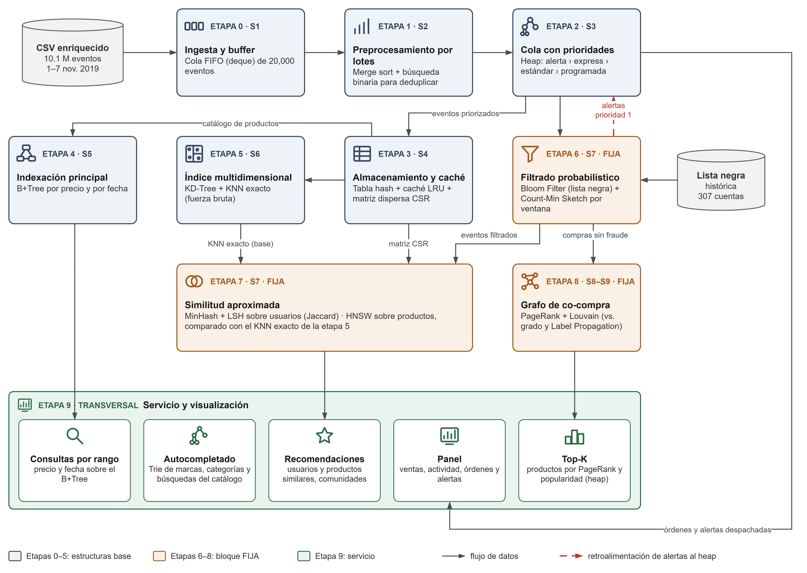

# Pipeline de procesamiento de data streams — Opción B: comercio electrónico

Proyecto final de **Estructuras de Datos y Algoritmos (2026-2)** — Maestría en Ciencia de Datos e Inteligencia Artificial, UTEC.
Docente: Heider Sánchez.

Pipeline de 10 etapas que procesa **10 millones de eventos** de una tienda online (vistas, carrito y compras). Cada etapa usa la estructura de datos más adecuada para su tarea, y su salida alimenta a las etapas siguientes: desde la cola de ingesta hasta las recomendaciones, el grafo de co-compra y el panel final.



## Etapas

| Etapa | Nombre | Estructuras / algoritmos | Salida hacia |
|---|---|---|---|
| 0 | Ingesta y buffer | Cola FIFO acotada (`deque`) | 1 |
| 1 | Preprocesamiento por lotes | Merge sort + búsqueda binaria (limpieza y deduplicación) | 2 |
| 2 | Cola con prioridades | Heap binario (alertas → express → estándar → programadas) | 3, 6, 9 |
| 3 | Almacenamiento, lookup y caché | Tabla hash, caché LRU y matriz dispersa CSR | 4, 5, 7 |
| 4 | Indexación principal | B+Tree (precio y fecha) | 9 |
| 5 | Índice multidimensional | KD-Tree + KNN exacto como línea base | 7 |
| 6 | Filtrado probabilístico | Bloom Filter + Count-Min Sketch por ventana | 2 (alertas), 7, 8 |
| 7 | Similitud aproximada | MinHash + LSH (usuarios) y HNSW (productos) | 9 |
| 8 | Grafo de co-compra | PageRank + comunidades (Louvain frente a Label Propagation) | 9 |
| 9 | Servicio y visualización | Trie (autocompletado), Top-K con heap, recomendaciones y panel | — |

## Resultados principales

| Etapa | Estructura | Resultado |
|---|---|---|
| 6 | Bloom Filter (lista negra) | 0.98 % de falsos positivos (objetivo 1 %) en 368 bytes |
| 6 | Count-Min Sketch por ventana | 905 cuentas alertadas; precisión 100 % y recall 93 % frente a la etiqueta |
| 7 | MinHash + LSH | recall 99.4 %; 9 veces más rápido que Jaccard exacto |
| 7 | HNSW (64 dimensiones) | recall@10 = 1.000; 7 veces más rápido que la fuerza bruta |
| 8 | PageRank | Top-10 coincide en 9 de 10 con el ranking por grado |
| 8 | Louvain frente a Label Propagation | modularidad 0.654 ± 0.002 frente a 0.546 ± 0.040 |
| 9 | Trie | autocompletado 782 veces más rápido que el recorrido lineal |
| 9 | Top-K con heap | 12.8 veces más rápido que ordenar todo el catálogo |

El notebook termina con el **recorrido de un evento de punta a punta** por las 10 etapas (sección 9.6).

## Estructura del repositorio

```
├── Proyecto_Ecommerce.ipynb          notebook principal (etapas 0–9, ya ejecutado)
├── scripts/
│   ├── generar_dataset_enriquecido.py      genera el stream de 10M eventos (semilla 42)
│   ├── benchmark_alternativas_etapas_0_5.py
│   └── benchmark_escalamiento_etapas_0_5.py
├── docs/                             diagrama del pipeline (.png y .drawio) y gráficos de escalamiento
├── datos/muestra_10k.csv             primeras 10,000 filas del dataset enriquecido
├── blacklist.csv                     lista negra histórica (Bloom Filter, etapa 6)
├── diccionario_columnas.md           columnas del dataset y reglas de derivación
├── salidas/                          resultados de los benchmarks y panel de la etapa 9
└── requirements.txt
```

## Datos

Base estructural: [eCommerce behavior data from multi category store](https://www.kaggle.com/datasets/mkechinov/ecommerce-behavior-data-from-multi-category-store) (REES46, Kaggle), archivo `2019-Nov.csv`. Se toman las primeras 10,000,000 filas (1 al 7 de noviembre de 2019).

Las columnas que el pipeline necesita y el dataset no trae (orden, tipo de orden, stock, búsquedas, etiqueta de fraude) se **derivan de los datos reales** con reglas deterministas. Lo único aleatorio, con semilla 42, es la suciedad inyectada para las etapas 0 y 1: 1 % de duplicados y 0.1 % de filas corruptas. El detalle está en [`diccionario_columnas.md`](diccionario_columnas.md).

Los archivos completos (2.7 GB el original y 1.5 GB el enriquecido) no se suben al repositorio por su tamaño. Para regenerarlos:

1. Descargar `2019-Nov.csv.zip` desde Kaggle y dejarlo en la raíz del repositorio.
2. Ejecutar `python scripts/generar_dataset_enriquecido.py --n 10000000 --seed 42`.
3. Descomprimir `2019-Nov-enriquecido.zip` en la raíz (deja `2019-Nov-enriquecido.csv` y `blacklist.csv`).

## Cómo ejecutar

```bash
pip install -r requirements.txt
jupyter notebook Proyecto_Ecommerce.ipynb
```

El notebook completo procesa 10M de eventos y necesita unos 16 GB de RAM libres. Se ejecutó en un Intel Core i5-12400F con 32 GB de RAM, Windows 11 Pro y Python 3.13.9.

## Roles y contribución individual

| Integrante | Responsable principal (≥ 2 etapas o 1 familia de algoritmos) | Aporte concreto |
|---|---|---|
| Mondragón, Harold | [completar] | [completar] |
| Julon Chamana, Sebastián | [completar] | [completar] |
| Bravo Andía, Adolfo Andrés | [completar] | [completar] |
| Mestas Ventocilla, Sergio Eduardo | [completar] | [completar] |

## Informe

`Proyecto_Final_[NombreGrupo].pdf` — pendiente de subir (versión final del informe técnico).

## Referencias principales

- Bloom, B. H. (1970). Space/time trade-offs in hash coding with allowable errors. *Communications of the ACM, 13*(7), 422–426.
- Cormode, G., & Muthukrishnan, S. (2005). An improved data stream summary: The Count-Min sketch and its applications. *Journal of Algorithms, 55*(1), 58–75.
- Broder, A. Z. (1997). On the resemblance and containment of documents. *Compression and Complexity of Sequences*, 21–29.
- Malkov, Y. A., & Yashunin, D. A. (2020). Efficient and robust approximate nearest neighbor search using HNSW graphs. *IEEE TPAMI, 42*(4), 824–836.
- Brin, S., & Page, L. (1998). The anatomy of a large-scale hypertextual Web search engine. *Computer Networks and ISDN Systems, 30*, 107–117.
- Blondel, V. D., et al. (2008). Fast unfolding of communities in large networks. *J. Stat. Mech.*, P10008.
- Raghavan, U. N., Albert, R., & Kumara, S. (2007). Near linear time algorithm to detect community structures. *Physical Review E, 76*(3), 036106.
